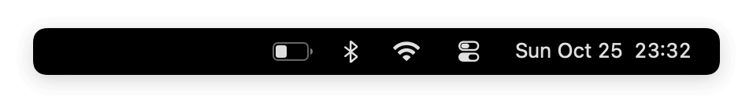
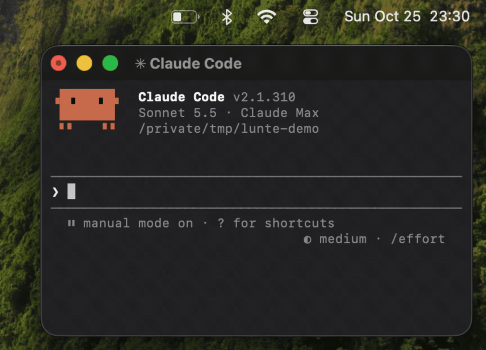

<h1 align="center">Lunte: dynamite in your menu bar</h1>

<p align="center">
  <picture>
    <source media="(prefers-color-scheme: dark)" srcset="docs/clips/menubar-dark.gif">
    
  </picture>
</p>

<p align="center">Lit by how you talk to your agent. Keep it cool and the Lunte grows. Turn up the heat, and it blows.</p>

<p align="center">
  <a href="https://github.com/ProggePal/lunte-app/releases/latest"></a>
</p>

<p align="center"><sub>Lunte never stores or sends your prompts.</sub></p>

Ask your agent to install it:

```
Hey dude, please install this for me: https://github.com/ProggePal/lunte-app
```

## How it works
<p align="center">
  
  <br><sub>Burn through it, it goes boom.</sub>
</p>

- **Heat and cool.** Frustration is heat. Casual is cool. Claude tunes this for you during setup.
- **The Lunte.** Heat burns it, and cool grows it back.
- **The Boom.** Burn through the Lunte and your Mac blows up a few seconds later. Keep the heat coming and it turns into a Chain reaction, then a Meltdown.
- **Sessions.** A session closes after 30 minutes without a prompt. Then you get a fresh stick and see how the session went.
- **Your Club.** Your Club gets a silent ping when you blow up, and you can comment if you want. Roasts, close calls and cool sessions earn your Club aura.
- **Leagues.** Invite other Clubs, race them every day, and the most points wins the week.

> [!NOTE]
> Lunte is a prototype. Version 0.2.2 has heat, a Lunte tuned to you, the Boom, and Clubs with pings, reactions and comments. Cool, sessions, aura and Leagues are coming next.

## Install
1. Ask your agent to install it, with the line at the top. Or download `Lunte-<version>.zip` from the [latest release](https://github.com/ProggePal/lunte-app/releases/latest), unzip it, and drag Lunte into Applications. It's signed and notarized, and it updates itself.
2. Open it, click Lunte in your menu bar, and follow the three steps: download the Heat Detector (483 MB, once), connect to Claude Code, and tune hot and cool to you. Then type `3 2 1 boom` in Claude Code for your first Boom.
3. Join a Club with its six-letter code, or create one, from the Club row in the popover.

You need a Mac with Apple Silicon and Claude Code.

### For your agent
Installing Lunte for someone? Check it's an Apple Silicon Mac (`uname -m` says `arm64`), then run:

```bash
curl -fsSL "$(curl -fsSL https://api.github.com/repos/ProggePal/lunte-app/releases/latest | grep -o 'https://[^"]*/Lunte-[^"]*\.zip' | head -1)" -o /tmp/Lunte.zip
ditto -x -k /tmp/Lunte.zip /Applications
open /Applications/Lunte.app
```

If Lunte is in Applications already, just open it: it updates itself. Then tell them to click Lunte in the menu bar and follow the three steps.

## Privacy
Lunte reads your prompts on your Mac and never stores or sends them. Only your Booms, reactions and comments go to your Club.
- The Heat Detector is a small model that runs on your Mac. Setup asks before downloading it, once, from Hugging Face (483 MB).
- During setup, one prompt asks your own AI to rate your recent messages, so Lunte learns how you normally talk. Those messages go to your AI provider like any other chat. Lunte keeps only the ratings.

Read [the promise](docs/adr/0001-everything-runs-on-your-computer.md).

## Ideas
Something you want in Lunte? Choose Submit a prompt… in Lunte's settings and it comes straight to us. You can also open an issue here with the prompt you'd give an agent to build it. If we keep it, you're credited in the [changelog](CHANGELOG.md).

## Credits
Heat is read by [Laya](https://huggingface.co/convaiinnovations/laya-multilingual) (Apache-2.0), running on your Mac through FluidInference's [CoreML build](https://huggingface.co/FluidInference/laya-coreml) and the [FluidUse](https://github.com/FluidInference/FluidUse) runtime (Apache-2.0).

Made in Oslo by Panter AS.
